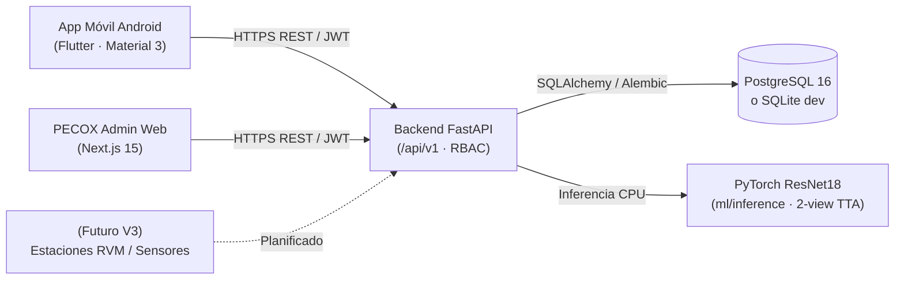

# PECOX Vision — AI-Powered Recycling Platform

Plataforma integral de **clasificación asistida de residuos** (`plastic`, `glass`, `metal`, `cardboard`, `paper`, `other`) compuesta por **app móvil Android en Flutter**, **API REST FastAPI + PostgreSQL**, **modelo de visión por computadora PyTorch (`ResNet18`)**, **dashboard administrativo Next.js 15** y **orquestación Docker + CI de seguridad**.

---

## 1. ¿Para qué sirve PECOX Vision?

La separación doméstica de residuos suele fallar por dos motivos: **dudar qué material es un envase** y **depositarlo sucio o mal preparado** (contaminando lotes reciclables completos).

**PECOX Vision** resuelve esto de extremo a extremo:
1. **Escanea y clasifica con IA:** fotografías un envase desde tu teléfono y el modelo `ResNet18` predice el material, su nivel de confianza y alternativas probables (con umbrales explícitos de incertidumbre `identified`, `low_confidence` y `unknown`).
2. **Guía práctica antes de reciclar:** muestra instrucciones concretas por material (*vacía, enjuaga, aplasta, tapa y excepciones locales*).
3. **Corrección manual y aprendizaje continuo:** si la predicción falla por luz o fondo complejo, el usuario corrige la etiqueta en 1 toque; las correcciones quedan guardadas en PostgreSQL para priorizar nuevas fotos reales sin almacenar imágenes privadas del usuario.
4. **Auditoría operativa en web (PECOX Admin):** consola administrativa para consultar métricas reales, filtrar clasificaciones, gestionar roles y auditar el rendimiento del modelo ML.

> **Principio de honestidad técnica:** Las pantallas identificadas como **Próximas funciones / Próxima etapa (V3)** reservan la integración futura con estaciones físicas IoT/RVM; ninguna gráfica ni vista muestra telemetría o cifras ecológicas ficticias.

---

## 2. Vista previa de la plataforma

### App Móvil Android (`apps/mobile`)

| Inicio y resumen sincronizado | Escáner inteligente | Guía por material | Historial y correcciones |
| :---: | :---: | :---: | :---: |
|  |  |  |  |

### Panel Administrativo Web (`apps/web` — PECOX Admin)

<p align="center">
  
</p>

### Evaluación del Modelo ML (`ml/evaluation/reports`)

<p align="center">
  
</p>

---

## 3. Arquitectura del sistema



| Capa | Ubicación | Tecnologías |
|---|---|---|
| Prototipo UI/UX | [`src/`](./src) | React 19, Vite 8, TypeScript, Tailwind CSS v4 |
| App Móvil Android | [`apps/mobile/`](./apps/mobile) | Flutter, Material 3, Riverpod, `dio`, `flutter_secure_storage`, `image_picker` |
| Backend REST | [`services/api/`](./services/api) | Python 3.12+, FastAPI, Pydantic v2, SQLAlchemy 2, Alembic, PostgreSQL |
| Machine Learning | [`ml/`](./ml) | PyTorch, torchvision (`ResNet18`), scikit-learn, Pillow |
| Dashboard Web Admin | [`apps/web/`](./apps/web) | Next.js 15, React 19, TypeScript, Tailwind CSS v4, Lucide, Vitest |
| Infraestructura y CI | [`infrastructure/`](./infrastructure), [`.github/workflows/`](./.github/workflows) | Docker Compose, Caddy TLS, GitHub Actions, Ruff, Pytest, Bandit, `pip-audit`, `pnpm audit` |

---

## 4. Métricas reales del modelo ML (`resnet18-trashnet-v1.0.0`)

Entrenamiento y evaluación reproducible sobre **TrashNet** deduplicado mediante SHA-256 (`2,524` imágenes únicas de `2,527` válidas, `0` fuga entre splits `train=1,803 / val=360 / test=361`):

| Métrica (split `test`, `n=361`) | Resultado medido |
|---|---|
| **Accuracy global** | **89.75%** |
| **Macro F1** | **0.8881** (`Macro Precision 0.8805`, `Macro Recall 0.9019`) |
| **Gating por confianza (`>= 0.50`)** | **91.97% cobertura** · **92.77% accuracy** sobre predicciones identificadas |
| **TTA 2 vistas (`ML_USE_TTA=true`)** | **89.75%** accuracy thresholded (`82.97 ms` CPU) vs `89.20%` (`45.07 ms`) en 1 vista |
| **Latencia CPU base (50 muestras)** | **41.01 ms** (P50) · **42.96 ms** (P95) |

Limitación documentada: TrashNet contiene objetos individuales sobre fondo controlado y presenta confusión visual ocasional entre vidrio transparente (`glass`, recall `79.17%`) y metal reflectivo (`metal`). Por ello, PECOX integra umbrales de incertidumbre (`>= 0.50` identificado, `0.35–0.49` baja confianza, `< 0.35` desconocido), 2-view TTA y aumentos `camera_robust` para adaptación con fotos reales en [`ml/datasets/real_world/`](./ml/datasets/real_world/README.md). Consulta [`ml/evaluation/reports/metrics.json`](./ml/evaluation/reports/metrics.json), [`ml/experiments/exp-002-camera-robust.md`](./ml/experiments/exp-002-camera-robust.md) y [`ml/README.md`](./ml/README.md).

---

## 5. Instalación y ejecución paso a paso

### Requisitos previos

- **Para arranque rápido con contenedores:** Docker + Docker Compose v2.
- **Para desarrollo local / entrenamiento / app móvil:** Python `>=3.12`, [`uv`](https://docs.astral.sh/uv/), Node.js `>=22`, `pnpm`, y **Flutter SDK** (`>=3.24`) + Android SDK para compilar la app móvil.

### Opción A — Docker Compose (`PostgreSQL + FastAPI + PECOX Admin`)

```bash
git clone https://github.com/luisgamboa3322/AppReciclaje.git
cd AppReciclaje
cp .env.example .env
docker compose up --build
```

- API FastAPI: `http://localhost:8000` (`/health`, `/docs`)
- Dashboard Web Admin: `http://localhost:3000`
- Para despliegue productivo con **Caddy TLS automático** y **PyTorch CPU**, revisa [`.env.production.example`](./.env.production.example), [`docker-compose.prod.yml`](./docker-compose.prod.yml) y [`infrastructure/README.md`](./infrastructure/README.md).

### Opción B — Instalación manual por módulo (desarrollo local)

1. **Entrenar / reproducir el modelo ML (`ml/`):**
   ```bash
   cd ml
   uv sync
   # Descarga TrashNet, genera splits sin fuga y entrena ResNet18 en CPU/GPU:
   PYTHONPATH=.. uv run python -m ml.run_pipeline --epochs 6 --freeze-epochs 2
   ```
   *(El binario `.pt` resultante queda en `ml/artifacts/best_checkpoint.pt`.)*

2. **Backend API (`services/api/`):**
   ```bash
   cd services/api
   uv sync
   uv run alembic upgrade head
   uv run python -m app.seed
   # Conecta el modelo ML local para inferencia real:
   PYTHONPATH="../..;../../ml/.venv/Lib/site-packages" \
     ML_ARTIFACT_DIR="../../ml/artifacts" \
     ML_MODEL_VERSION="resnet18-trashnet-v1.0.0" \
     ML_USE_TTA="true" \
     uv run uvicorn app.main:app --host 0.0.0.0 --port 8000
   ```

3. **Dashboard Web Admin (`apps/web/`):**
   ```bash
   cd apps/web
   pnpm install
   pnpm dev   # Abre http://localhost:3000
   ```
   Cuenta admin seed por defecto (solo desarrollo local): `admin@pecox.dev` / `AdminPecox2026!`.

4. **App Móvil Android (`apps/mobile/`):**
   ```bash
   cd apps/mobile
   flutter pub get
   # Emulador Android:
   flutter run --dart-define=PECOX_API_URL=http://10.0.2.2:8000/api/v1
   # O compilar APK instalable apuntando a tu servidor / IP local:
   flutter build apk --release --dart-define=PECOX_API_URL=https://api.tu-dominio.com/api/v1
   ```
   También puedes cambiar la URL de la API en tiempo de ejecución tocando la etiqueta `CONEXIÓN SEGURA` en la pantalla de login o desde **Perfil → Servidor y modelo ML**.

---

## 6. Verificación y pruebas automatizadas

| Módulo | Comandos de verificación |
|---|---|
| Prototipo (`src/`) | `pnpm exec tsc --noEmit` · `pnpm build` |
| Backend (`services/api`) | `uv run ruff check app tests alembic` · `uv run pytest -v` |
| ML (`ml/`) | `uv run ruff check .` · `uv run pytest -v` |
| Móvil (`apps/mobile`) | `flutter analyze` · `flutter test` |
| Web Admin (`apps/web`) | `pnpm typecheck` · `pnpm lint` · `pnpm test` · `pnpm build` |
| Seguridad | `uvx bandit -r app -ll` · `uvx pip-audit --local` · `pnpm audit --prod` |

---

## 7. Roadmap

- [x] **Fase 0** — Especificación (SRS, arquitectura, ADR-0001, OpenAPI draft, design system) y prototipo interactivo de 14 pantallas.
- [x] **Fase 1** — App móvil Flutter con flujos completos y pruebas de widget.
- [x] **Fase 2** — Backend FastAPI, JWT, RBAC, PostgreSQL y migraciones Alembic.
- [x] **Fase 3** — Dataset auditado (TrashNet), entrenamiento `ResNet18`, calibración de umbrales y servicio `/api/v1/predict`.
- [x] **Fase 4** — Integración end-to-end Flutter ↔ FastAPI ↔ PyTorch (MVP 1.0).
- [x] **Fase 5** — Dashboard Web administrativo Next.js + endpoints V2 de analítica y RBAC.
- [x] **Fase 6** — Endurecimiento de seguridad, contenedores Docker no-root, CI y documentación de portafolio.
- [x] **Opción A** — Robustez en cámara real (2-view TTA, perfil `camera_robust`, active learning sin PII y stack productivo Caddy TLS).
- [ ] **Fase 7** — Hardware RVM físico e integración IoT autenticado (próxima etapa opcional).

---

## 8. Documentación técnica y licencias

- [SRS](./docs/requirements/srs.md) · [Arquitectura](./docs/architecture/system.md) · [ADR-0001](./docs/architecture/adr/0001-modular-monolith-and-mobile-first.md)
- [Design System](./docs/ui-ux/design-system.md) · [Pantallas](./docs/ui-ux/screens.md) · [OpenAPI Draft](./docs/api/openapi-draft.md)
- [Infraestructura Docker](./infrastructure/README.md) · [Política de Seguridad](./SECURITY.md) · [Guía de Contribución](./CONTRIBUTING.md)
- **Licencia del código:** [MIT](./LICENSE). La referencia estética de Dribbble y el dataset TrashNet se utilizan únicamente bajo atribución e investigación conforme a sus términos originales.
